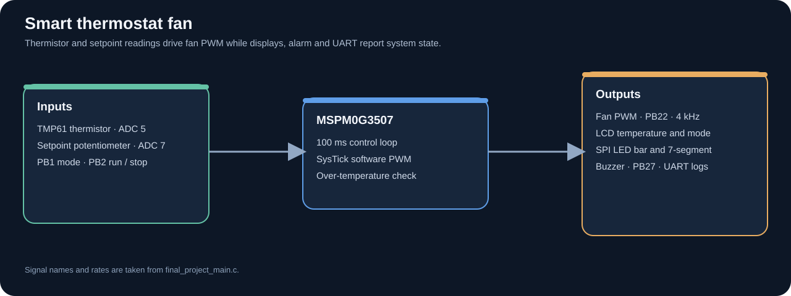

# Smart Thermostat Fan

Bare-metal C and Assembly firmware for a TI LP-MSPM0G3507 LaunchPad and CSC202 expansion board. The controller reads a TMP61 thermistor and a target-temperature potentiometer, adjusts fan duty, displays system status, and sounds an over-temperature alarm.

## Behavior

- Pushbutton 2 starts or stops the controller; Pushbutton 1 selects the thermistor or potentiometer demo input.
- ADC channels 5 and 7 read the thermistor and setpoint potentiometer.
- A 100 ms control cycle updates the fan output. Software PWM runs at 4 kHz on PB22.
- The LCD displays measured temperature, target temperature, and mode. SPI peripherals show fan duty, and UART diagnostics run at 115200 baud.
- The buzzer sounds when measured temperature reaches at least 10 °F above the target.

## Source files

| File | Responsibility |
| --- | --- |
| `final_project_main.c` | Input processing, fan control, display updates, interrupts, and alarm logic |
| `adc.*`, `clock.*` | ADC and clock support |
| `LaunchPad.*` | Board-level definitions |
| `lcd1602.*` | Character LCD interface |
| `spi.*`, `uart.*` | SPI display and serial diagnostics |
| `mspm0g3507.cmd` | Device linker command file |

## Build

Build with Code Composer Studio, the MSPM0 SDK, and the course expansion-board definitions. This source folder does not include generated workspace metadata or build outputs, so create or import a CCS project and add the listed source files for the target board.

The application header credits Tyler Mulvehill and Hakan Demirtas. Support files retain their original attributions and copyright notices; the TI linker command file retains its redistribution terms.
